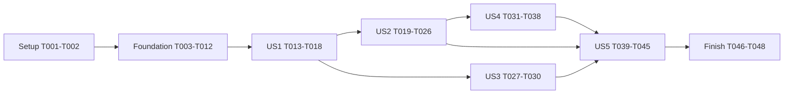

# Tasks: AI Chat Foundation & SSE Contract

**Feature**: 007-ai-chat-foundation  
**Created**: 2026-11-13  
**Status**: 48/48 구현 및 로컬 검증 완료 (2026-11-14)  
**Input**: `/private/tmp/douid-phase07/apps/api/specs/007-ai-chat-foundation`  
**Branch**: `feature/59-ai-chat-foundation` — #59 전용 `/private/tmp/douid-phase07` worktree

**Prerequisites**: [spec.md](spec.md), [plan.md](plan.md), [research.md](research.md), [data-model.md](data-model.md), [API 계약](contracts/ai-chat-api.md), [quickstart.md](quickstart.md)

## 실행 규칙

모든 경로는 절대 경로다. 새 Java 프로젝트/의존성/테이블/프런트엔드는 만들지 않는다. 기존 ai/shared의 지침을 실제 구현 전에 재확인한다. 코드명은 계획의 경계에 필요한 최소 타입 배치이며 단순 record/nested type을 억지로 별도 wrapper로 늘리지 않는다.

SPEC이 자동화 테스트를 명시하므로 테스트 작업을 포함한다. 각 스토리는 Tests→Implementation 순서이며, 나열된 테스트 다음에 대응 구현을 진행한다. 없는 타입으로 발생한 컴파일 오류만을 행동 검증의 실패 증거로 삼지 말고 계약 타입을 마련한 뒤 assertion 실패→통과를 확인한다. 구현 후 관련 테스트가 통과하면 다음 checkpoint로 진행한다.

[P]는 아래에 명시한 같은 단계 내 서로 다른 파일 작업의 병렬 가능성만 의미한다. 이전 phase/명시적 선행 작업을 건너뛰거나 자동으로 서브에이전트를 실행하라는 지시가 아니다. 공용 use case/config/security/handler 파일을 바꾸는 스토리는 순서대로 통합한다.

이번 명령은 tasks.md만 생성한다. 이하 체크박스는 향후 실행 대상이며 현재 구현/테스트 완료가 아니다. 기존 plan/quickstart의 “tasks 미작성” 표현은 해당 계획 실행 당시의 상태 기록으로 해석한다. 실제 구현 착수 시 프로젝트의 이슈/브랜치 절차를 별도로 적용하며 이번에는 브랜치를 만들지 않는다. staging/commit/push도 자동 실행하지 않는다.

## Phase 1: Setup — 기존 환경과 작업 범위 확인

새 프로젝트·의존성을 만들지 않는다. 이번 목록을 실행할 때의 기준 상태와 실제 resolved 환경을 확인한다.

- [X] T001 Git 루트·적용 CLAUDE/rules·기존 미커밋 변경을 다시 확인하고 영향 경로와 보존할 변경을 `/private/tmp/douid-phase07/apps/api/specs/007-ai-chat-foundation/quickstart.md`에 기록; `/private/tmp/douid-phase07/apps/api/build.gradle`과 ai/shared 지침을 기준으로 작업 범위를 고정
- [X] T002 Java 25·Gradle wrapper·실제 Spring/Jackson resolved 버전과 Docker 가용성을 확인하고 `/private/tmp/douid-phase07/apps/api/build.gradle` 기준 기존 테스트 결과/실행 불가 원인을 `/private/tmp/douid-phase07/apps/api/specs/007-ai-chat-foundation/quickstart.md`에 기록; 버전 변경이나 신규 의존성 추가 없이 기준 상태 확보

**Checkpoint**: 이후 작업에 필요한 환경과 기존 실패/변경이 구분되어 있다. 이 단계가 실패하면 원인을 해결하거나 명확히 기록하고 새 작업의 성공으로 덮지 않는다.

## Phase 2: Foundational — 공통 계약과 유한 자원 기반

모든 스토리의 선행 조건이다. 테스트는 대응 구현 전에 추가하고 관찰 가능한 실패를 확인한다. 이 단계에서 공개 endpoint나 운영 가짜 답변은 만들지 않는다.

- [X] T003 [P] 설정 기본값·환경별 바인딩·positive/worker 1..64·timeout 순서·context/message 관계·byte +1 overflow 거부 테스트를 `/private/tmp/douid-phase07/apps/api/src/test/java/kr/douid/brand/ai/infrastructure/config/AiChatPropertiesTest.java`에 작성
- [X] T004 [P] 공통 JSON 400/413/415/406/429/503/504/500 매핑, SSE Accept에서도 JSON 오류, Retry-After의 중립 전달 계약과 기존 오류 응답 보존 테스트를 `/private/tmp/douid-phase07/apps/api/src/test/java/kr/douid/brand/shared/presentation/GlobalExceptionHandlerTest.java`에 추가
- [X] T005 `/private/tmp/douid-phase07/apps/api/src/main/java/kr/douid/brand/ai/infrastructure/config/AiChatProperties.java`와 `/private/tmp/douid-phase07/apps/api/src/main/resources/application.yaml`에 API 계약의 12개 정책/AI_CHAT_* 환경변수 바인딩과 시작 시 검증을 구현; 실행 기한 60s, emitter 65s, 출력 65536 bytes/4096 Delta를 포함하고 application에는 immutable 값만 전달
- [X] T006 `/private/tmp/douid-phase07/apps/api/src/main/java/kr/douid/brand/shared/presentation/GlobalExceptionHandler.java`, `/private/tmp/douid-phase07/apps/api/src/main/java/kr/douid/brand/shared/presentation/ErrorHttpStatusMapper.java`, `/private/tmp/douid-phase07/apps/api/src/main/java/kr/douid/brand/shared/exception/DomainErrorType.java`에 표준 HTTP 입력 오류와 TOO_MANY_REQUESTS 분류/안전한 JSON·Retry-After 매핑을 구현; ai 예외 import 없이 중립 계약을 사용하고 기존 CMS 오류 상태를 보존
- [X] T007 `/private/tmp/douid-phase07/apps/api/src/main/java/kr/douid/brand/ai/application/AiChatCommand.java` 및 `/private/tmp/douid-phase07/apps/api/src/main/java/kr/douid/brand/ai/application/port/LlmGateway.java`에 ordered history와 준비/단일 실행/순차 sink/activation/취소/실행 제출/점유 계약을 선언; 같은 port 패키지의 필요한 타입만 추가하고 Servlet/SSE/provider 타입 유입 및 중복 gateway 금지
- [X] T008 latch로 Delta·정상 반환·오류·취소 관찰을 제어하는 test-only gateway와 TestConfiguration을 `/private/tmp/douid-phase07/apps/api/src/test/java/kr/douid/brand/ai/testsupport/ControlledLlmGateway.java` 및 `/private/tmp/douid-phase07/apps/api/src/test/java/kr/douid/brand/ai/testsupport/AiChatTestConfiguration.java`에 작성; 운영 source selector 없이 테스트별 상태 초기화/유한 대기 제공
- [X] T009 [P] 고정 창 30/60초·31번째 거부·창 교체·atomic 경쟁·8개 점유·중복 반환과 Retry-After 테스트를 `/private/tmp/douid-phase07/apps/api/src/test/java/kr/douid/brand/ai/infrastructure/guard/InMemoryChatRequestGuardTest.java`에 작성; monotonic time을 제어하고 실제 60초 sleep 금지
- [X] T010 [P] worker 상한·대기열 없음·제출 거부·취소가 실행 종료를 뜻하지 않음·timer 취소 제거·context 종료 시 자원 정리 테스트를 `/private/tmp/douid-phase07/apps/api/src/test/java/kr/douid/brand/ai/infrastructure/stream/BoundedChatStreamExecutorTest.java`에 작성
- [X] T011 `/private/tmp/douid-phase07/apps/api/src/main/java/kr/douid/brand/ai/infrastructure/guard/InMemoryChatRequestGuard.java`에 프로세스 전역 fixed window와 idempotent 실행 lease를 구현; IP/쿠키별 맵·Redis 없이 빈도 시도는 실패해도 반환하지 않고 점유 반환은 실행 소유자가 결정
- [X] T012 `/private/tmp/douid-phase07/apps/api/src/main/java/kr/douid/brand/ai/infrastructure/stream/BoundedChatStreamExecutor.java`에 고정 ThreadPoolExecutor/SynchronousQueue/AbortPolicy와 단일 deadline scheduler를 구현; application port로만 노출하고 scheduler의 네트워크 쓰기/lock 대기·무제한 queue/virtual thread 금지

**Checkpoint**: T003/T004/T009/T010의 테스트가 통과하고 계약·설정·guard·executor·test source가 준비된다. T003/T004와 T009/T010은 각각 같은 단계 내에서만 병렬 후보이며 구현은 선행 테스트 뒤 진행한다.

## Phase 3: User Story 1 — 비회원 질문 제출 (P1)

**Goal**: 현재 질문과 선택적 이력을 검증된 application 입력으로 전달하고, 실제 처리기 미준비는 안전하게 거부한다.

**Independent Test**: Servlet 입력을 흉내 낸 reader 단위 테스트와 Mockito application 테스트로 이력 생략/[]·익명 입력·잘못된 JSON·준비/거부 시 source 소유권을 확인한다. 공개 HTTP 연결은 US2에서 완성하므로 이 checkpoint는 전송 계층과 독립된 요청 수락 경계다.

### Tests

- [X] T013 [P] [US1] 빈/생략 이력·잘못된 JSON/필수 필드/자료형·전체 byte L-1/L/L+1·Content-Length 없는 입력·trailing/duplicate/unknown field 거부 테스트를 `/private/tmp/douid-phase07/apps/api/src/test/java/kr/douid/brand/ai/presentation/AiChatRequestReaderTest.java`에 작성
- [X] T014 [P] [US1] 입력 검증→gateway local prepare→lease 획득 순서, 미준비 503, 거부 시 미실행/source close·lease 누수 없음 테스트를 `/private/tmp/douid-phase07/apps/api/src/test/java/kr/douid/brand/ai/application/AiChatUseCaseTest.java`에 작성; Admin/방문자 식별자 의존 없음 확인
### Implementation

- [X] T015 [US1] `/private/tmp/douid-phase07/apps/api/src/main/java/kr/douid/brand/ai/presentation/AiChatRequestReader.java`와 `/private/tmp/douid-phase07/apps/api/src/main/java/kr/douid/brand/ai/presentation/AiChatRequest.java`에 max bytes+1 읽기·endpoint 전용 strict Jackson tree 검사·request record→command 변환을 구현; history 생략/null 구분, 숫자/boolean 문자열 coercion 및 전역 mapper 변경 금지
- [X] T016 [US1] `/private/tmp/douid-phase07/apps/api/src/main/java/kr/douid/brand/ai/application/AiChatUseCase.java`에 요청 시도 확인·기본 비공백 입력 검증·local gateway 준비·동시 lease 획득 및 준비 실패 정리를 구현; HTTP DTO/세션을 받지 않고 핵심 흐름을 listener로 위임하지 않음
- [X] T017 [US1] `/private/tmp/douid-phase07/apps/api/src/main/java/kr/douid/brand/ai/infrastructure/stream/UnavailableLlmGateway.java`에 AI_UNAVAILABLE/SERVICE_UNAVAILABLE 실패 adapter를 구현하고 `/private/tmp/douid-phase07/apps/api/src/main/java/kr/douid/brand/ai/application/AiChatException.java`에 feature 고유 안전 코드/예외를 정의; 원문/키/실제 AI 호출/운영 fake 응답 없음
- [X] T018 [US1] `/private/tmp/douid-phase07/apps/api/src/main/java/kr/douid/brand/ai/infrastructure/config/AiChatConfig.java`에 immutable 정책·guard·executor·기본 unavailable gateway·use case를 연결하고 T013/T014의 요청 경계 테스트를 통과시킴; test-only source가 기본 bean으로 선택되지 않도록 구성

**Checkpoint**: 첫 질문과 이력이 application 준비 경계까지 전달된다. 운영 기본 동작은 명확한 unavailable이며 정상 HTTP/SSE endpoint가 완성되었다고 표시하지 않는다. US3의 모든 맥락/권한 경계 및 US4/US5 검증 전 공개 배포 금지.

## Phase 4: User Story 2 — 점진적인 SSE 수신 (P1)

**Goal**: 같은 POST에서 started·여러 Delta·completed와 EOF를 관찰한다.

**Independent Test**: test-only gateway를 사용해 MockMvc의 유한 계약과 랜덤 포트 JDK HttpClient의 첫 Delta 조기 수신을 별도로 검증한다.

### Tests

- [X] T019 [P] [US2] POST 200/text/event-stream·정확한 4종 이벤트 data·started 1개·Delta 0/N개·completed·헤더·JSON escaping/framing 테스트를 `/private/tmp/douid-phase07/apps/api/src/test/java/kr/douid/brand/ai/presentation/AiChatControllerTest.java`에 작성; 테스트에서 source와 보안 의존성을 명시적으로 주입
- [X] T020 [P] [US2] RANDOM_PORT + 기존 PostgresIntegrationTest + JDK HttpClient InputStream으로 source 완료 latch 이전 첫 Delta·다중 Delta 순서·UTF-8/개행/특수문자·최종 EOF를 검증하는 `/private/tmp/douid-phase07/apps/api/src/test/java/kr/douid/brand/ai/presentation/AiChatStreamingIntegrationTest.java`를 작성; 네트워크 chunk 경계를 event 경계로 가정하지 않음
### Implementation

- [X] T021 [US2] `/private/tmp/douid-phase07/apps/api/src/main/java/kr/douid/brand/ai/presentation/stream/AiChatSsePresenter.java`에 event data records·SseEmitter JSON 변환·기본 정상/실패 terminal·출력 byte/Delta 예산과 단일 writer를 구현; raw event data를 유지하고 started 쓰기 성공 전 source 실행 금지
- [X] T022 [US2] `/private/tmp/douid-phase07/apps/api/src/main/java/kr/douid/brand/ai/presentation/stream/AiChatAsyncInterceptor.java`에 정확 endpoint의 afterConcurrentHandlingStarted→activation 신호와 초기화 실패 폐기를 구현; 초기화 전 send/complete 금지, application에는 Servlet 없는 준비 신호만 전달
- [X] T023 [US2] `/private/tmp/douid-phase07/apps/api/src/main/java/kr/douid/brand/ai/application/AiChatUseCase.java`와 `/private/tmp/douid-phase07/apps/api/src/main/java/kr/douid/brand/ai/application/AiChatExecution.java`에 executor port를 통한 start·activation 대기·started 이후 단일 source 실행·순차 sink·정상 완료·실행 소유권 기반 close를 연결; presenter의 infrastructure 직접 호출 금지
- [X] T024 [US2] `/private/tmp/douid-phase07/apps/api/src/main/java/kr/douid/brand/ai/presentation/AiChatController.java`에 POST /api/public/ai-chat/stream의 consumes/produces·빈도 확인→bounded reader→use case prepare/start→emitter 반환을 연결; 제출 거부는 반환 전 429, source 준비 미완료는 JSON 503, 세션/식별자 요구 없음
- [X] T025 [US2] `/private/tmp/douid-phase07/apps/api/src/main/java/kr/douid/brand/shared/config/SecurityConfig.java`에 정확한 채팅 POST matcher만 CSRF 예외로 추가; 기존 Admin Session/Cookie CSRF·public/admin·기본 거부·CORS는 유지하고 전역 stateless/dispatcher permitAll 금지
- [X] T026 [US2] `/private/tmp/douid-phase07/apps/api/src/main/java/kr/douid/brand/ai/infrastructure/config/AiChatConfig.java`에 SSE presenter·endpoint 한정 interceptor 등록·수명주기 bean을 연결하고 T019/T020의 MockMvc/실제 HTTP 테스트 통과 확인; no-store/no-transform/X-Accel-Buffering 헤더와 source 초기화 순서 검증

**Checkpoint**: 통신 계약의 정상 경로를 로컬에서 시연할 수 있다. 운영은 여전히 unavailable 503이며, lifecycle·보안 회귀가 완료되기 전에는 Phase 07 완료나 배포 가능으로 표시하지 않는다.

## Phase 5: User Story 3 — 신뢰할 수 없는 맥락 차단 (P1)

**Goal**: 역할·Unicode 텍스트·누적 맥락 한도와 비신뢰성/불변성을 application 경계까지 보장한다.

**Independent Test**: source 실행 횟수를 관찰하며 모든 부적합 입력이 시작 전에 거부되고 유효한 assistant 이력도 사용자 입력 그대로 전달되는지 검증한다.

### Tests

- [X] T027 [P] [US3] 질문/이력별/개수/누적 code-point L-1/L/L+1, Unicode whitespace/space character·한글/이모지·역할 정확 일치·순서 유지·방어복사 테스트를 `/private/tmp/douid-phase07/apps/api/src/test/java/kr/douid/brand/ai/application/AiChatUseCaseTest.java`에 추가; application 직접 호출도 동일 검증
- [X] T028 [P] [US3] system/developer/tool/대소문자·null 이력/항목·숫자/boolean·서버 제어 필드 조작 거부, 유효 assistant 비신뢰성, oversized/chunked 입력의 SSE/source 미시작을 `/private/tmp/douid-phase07/apps/api/src/test/java/kr/douid/brand/ai/presentation/AiChatValidationTest.java`에 작성
### Implementation

- [X] T029 [US3] `/private/tmp/douid-phase07/apps/api/src/main/java/kr/douid/brand/ai/application/AiChatUseCase.java`에 질문 2000/이력 12개·개별 2000/누적 12000 code points와 모든 역할/비공백 검증을 완성; 각 한도는 설정값 기준, 원문 trim/절단·권한 상승·서버 지시문 혼합 금지
- [X] T030 [US3] `/private/tmp/douid-phase07/apps/api/src/main/java/kr/douid/brand/ai/application/AiChatCommand.java`와 `/private/tmp/douid-phase07/apps/api/src/main/java/kr/douid/brand/ai/presentation/AiChatRequestReader.java`의 immutable history snapshot·신뢰 경계·배열 순서·엄격 자료형 변환을 완성하고 T027/T028 통과; assistant도 client-provided이며 gateway에 시스템 정책/권한 제어값이 전달되지 않음 확인

**Checkpoint**: malformed/과도한/위조 role 입력은 stream/source 시작 전에 거부되고, 정상 이력은 순서와 텍스트 원형이 보존된다. US2 transport를 교체하지 않고 검증한다.

## Phase 6: User Story 4 — 오류·타임아웃·단절·취소 (P1)

**Goal**: 성공과 실패를 구분하고 초기화/쓰기/취소/종료 경합에도 연결과 실행 자원을 유한하게 관리한다.

**Independent Test**: 단위 latch/barrier와 짧은 테스트 전용 timeout의 실제 HTTP로 terminal 최대 1개·이후 Delta 0개·취소 요청·실행/연결 이중 종료 후 점유 반환을 확인한다.

### Tests

- [X] T031 [P] [US4] handle 등록 전후 취소·cancel-before-start·완료/오류/deadline 중복/경합·취소 무시 worker·worker/transport 종료 순서 양쪽의 점유 반환 테스트를 `/private/tmp/douid-phase07/apps/api/src/test/java/kr/douid/brand/ai/application/AiChatExecutionTest.java`에 작성; Future.isDone만으로 반환하지 않는지 검증
- [X] T032 [P] [US4] started/Delta/completed 쓰기 실패·부분 답변 후 error·terminal 뒤 send 차단·출력 예산 경계·callback 중복·오류 event 자체 실패 테스트를 `/private/tmp/douid-phase07/apps/api/src/test/java/kr/douid/brand/ai/presentation/stream/AiChatSsePresenterTest.java`에 작성
- [X] T033 [US4] 활성화 전 deadline→504 JSON·초기화 실패·늦은 activation no-op·부분 Delta 뒤 오류·client close 후 후속 write·application/emitter timeout·async/error 재디스패치·JSON 오염 없음 및 외부 /error/다른 원래 요청의 ERROR dispatch 기본 거부 시나리오를 `/private/tmp/douid-phase07/apps/api/src/test/java/kr/douid/brand/ai/presentation/AiChatLifecycleIntegrationTest.java`에 작성
### Implementation

- [X] T034 [US4] `/private/tmp/douid-phase07/apps/api/src/main/java/kr/douid/brand/ai/application/AiChatExecution.java`에 첫 종료 사유 선점·취소 등록 경합·non-blocking cancel·Future interrupt·수락 시 deadline·pending pre-activation timeout을 구현; source의 정상 반환이 기존 실패를 성공으로 뒤집지 않도록 처리
- [X] T035 [US4] `/private/tmp/douid-phase07/apps/api/src/main/java/kr/douid/brand/ai/presentation/stream/AiChatSsePresenter.java`에 STREAM_FAILED/STREAM_TIMEOUT/STREAM_LIMIT_EXCEEDED와 retryable 매핑·terminal 1회·전송 실패 비성공 판정을 완성; onTimeout/onError/onCompletion에서 추가 쓰기 금지, IOException 뒤 complete/completeWithError 재호출 금지
- [X] T036 [US4] `/private/tmp/douid-phase07/apps/api/src/main/java/kr/douid/brand/ai/presentation/stream/AiChatAsyncInterceptor.java`와 `/private/tmp/douid-phase07/apps/api/src/main/java/kr/douid/brand/shared/presentation/GlobalExceptionHandler.java`에 첫 write 전 pending timeout의 초기화 후 504 JSON dispatch, 폐기 gate no-op, 커밋 후 SSE의 일반 JSON 변환 차단을 연결; `/private/tmp/douid-phase07/apps/api/src/main/java/kr/douid/brand/shared/config/SecurityConfig.java`에는 원래 method/path가 정확한 채팅 POST인 내부 ERROR dispatch만 허용하는 범위를 T038 전에 구현하고 외부 /error/다른 요청의 기본 거부 유지; 미커밋 timeout 외에 completeWithError를 스트림 실패 전송으로 쓰지 않음
- [X] T037 [US4] `/private/tmp/douid-phase07/apps/api/src/main/java/kr/douid/brand/ai/application/AiChatExecution.java`와 `/private/tmp/douid-phase07/apps/api/src/main/java/kr/douid/brand/ai/infrastructure/stream/BoundedChatStreamExecutor.java`에 source finally·최종 onCompletion 양쪽 확인 후 lease 한 번 반환, 미실행 실패 별도 반환·timer 제거·종료 시 실행 자원 정리를 완성; worker/transport 한쪽만 끝난 경우 점유 유지
- [X] T038 [US4] T031~T033 테스트를 실행하고 `/private/tmp/douid-phase07/apps/api/specs/007-ai-chat-foundation/quickstart.md`에 정상/오류/timeout/단절/쓰기 실패/경합별 실제 결과를 기록; 원인만 안전하게 기록하고 즉시 취소·terminal 전달·강제 blocking-write 중단을 보장했다고 표시하지 않음

**Checkpoint**: 종료 상태와 전송 성공 여부가 분리되고, 커밋 후 오류가 HTTP 성공 완료나 일반 JSON으로 오인되지 않는다. 취소를 무시하는 실행은 용량을 점유한 채 제한되며 무제한 새 실행으로 우회되지 않는다.

## Phase 7: User Story 5 — 기존 보안 보존·환경 분리·로컬 검증 (P1)

**Goal**: 공개 채팅의 실제 요청 제한과 기본 503, 기존 Admin/CMS 정책 및 대화 비저장을 통합 검증한다.

**Independent Test**: OpenAI/OCI/Redis 없이 기존 PostgreSQL Testcontainers 기반 app에서 보안·guard·두 환경 설정·개인정보/스키마 검증을 실행한다.

### Tests

- [X] T039 [P] [US5] `/private/tmp/douid-phase07/apps/api/src/test/java/kr/douid/brand/shared/config/SecurityConfigTest.java`와 `/private/tmp/douid-phase07/apps/api/src/test/java/kr/douid/brand/shared/config/CsrfCookieFlowTest.java`에 익명 채팅·쿠키 동반 우대 없음·세션 미생성·다른 POST의 CSRF 유지·기존 login/logout/me/인가·Origin/preflight·폐기 API 및 외부 /error 기본 거부 회귀를 추가; 실제 CSRF 쿠키 흐름을 csrf() mock과 분리
- [X] T040 [P] [US5] 서로 다른 2개 정책/Origin 설정의 바인딩·동일 계약·기본 unavailable 503 및 test-only bean 미선택을 `/private/tmp/douid-phase07/apps/api/src/test/java/kr/douid/brand/ai/infrastructure/config/AiChatConfigurationTest.java`에 검증; malformed/503/동시 거부의 rate 소비·재디스패치 미중복·Retry-After·8개 실행/연결 상한은 `/private/tmp/douid-phase07/apps/api/src/test/java/kr/douid/brand/ai/presentation/AiChatGuardIntegrationTest.java`에서 검증
- [X] T041 [P] [US5] canary 질문/이력/답변·fake secret·provider/JSON 예외를 이용해 로그와 JSON/SSE 오류에 원문·내부 예외가 노출되지 않는지 `/private/tmp/douid-phase07/apps/api/src/test/java/kr/douid/brand/ai/presentation/AiChatPrivacyTest.java`에 검증; 안전한 requestId/종료 사유만 관찰
- [X] T042 [P] [US5] 기존 Flyway baseline의 client/conversation/message 계열 행 수가 채팅 정상/실패 전후 변하지 않고, 테스트 전용 SQL 관찰로 측정 구간의 대상 테이블 INSERT/UPDATE/DELETE가 0회이며 새 entity/repository/migration이 없음을 `/private/tmp/douid-phase07/apps/api/src/test/java/kr/douid/brand/ai/presentation/AiChatStatelessIntegrationTest.java`에 검증; 앱의 해당 테이블 사용 금지와 테스트용 count 조회를 구분; fixture 준비 SQL은 측정 전에 끝내고 rollback된 쓰기도 관찰하며 SQL 값/파라미터 로그와 새 테이블 생성/삭제 금지
### Implementation

- [X] T043 [US5] `/private/tmp/douid-phase07/apps/api/src/main/java/kr/douid/brand/shared/config/SecurityConfig.java`, `/private/tmp/douid-phase07/apps/api/src/main/java/kr/douid/brand/ai/infrastructure/config/AiChatConfig.java`, `/private/tmp/douid-phase07/apps/api/src/main/resources/application-prod.yaml`의 환경별 Origin/정책 연결을 완성하고 T025/T036의 정확 endpoint·내부 redispatch 보안 범위를 회귀 확인; 기존 Admin 체인·APP_ALLOWED_ORIGINS와 AI_CHAT_* 사용, 미준비 운영 503 유지, 새 proxy/Redis/메일 인프라 요구 없음
- [X] T044 [US5] `/private/tmp/douid-phase07/apps/api/src/main/java/kr/douid/brand/ai/application/AiChatExecution.java`와 `/private/tmp/douid-phase07/apps/api/src/main/java/kr/douid/brand/ai/presentation/stream/AiChatSsePresenter.java`에 안전한 requestId·코드·소요 시간·종료 사유만 남기는 진단을 연결; parser/provider throwable의 메시지·본문 로깅을 금지하고 T041의 canary 누출을 차단
- [X] T045 [US5] T039~T042의 보안/guard/설정/privacy/비저장 검증과 기존 Admin 인증 회귀를 실행하고 `/private/tmp/douid-phase07/apps/api/specs/007-ai-chat-foundation/quickstart.md`에 결과·Docker 의존 여부·환경 차이를 기록; 실제 배포/HTTPS/proxy 검증은 미수행으로 구분

**Checkpoint**: US1~US5 전체 P1의 보안·자원·개인정보·로컬 독립 검증이 완료되어야 Phase 07 완료 판단으로 넘어간다. 운영 기본값은 실제 AI 미준비 503이다.

## Phase 8: Polish & Cross-Cutting Concerns — 완료 근거 정리

기능 추가나 후속 Phase 구현 없이 전체 회귀와 산출물의 정확성을 확인한다.

- [X] T046 `/private/tmp/douid-phase07/apps/api/build.gradle`의 기존 Gradle test로 Category/Media/Work/Admin/AI 전체 회귀를 실행하고 `/private/tmp/douid-phase07/apps/api/specs/007-ai-chat-foundation/quickstart.md`에 실제 실행 명령·케이스별 결과·실패/미실행을 기록; 앞선 검증 후 변경이 없다면 의미 없이 전체 테스트를 반복하지 않음
- [X] T047 `/private/tmp/douid-phase07/apps/api/specs/007-ai-chat-foundation/contracts/ai-chat-api.md`와 실제 요청/이벤트/상태/한도/취소 동작을 대조하고 `/private/tmp/douid-phase07/apps/api/specs/007-ai-chat-foundation/plan.md`에 최종 설계 적합성을 기록; 변경 코드의 JavaDoc·계층 의존·새 의존성/스키마/프런트엔드 침범이 없는지 diff 검토, 테스트를 약화해 계약 차이를 덮지 않음
- [X] T048 `/private/tmp/douid-phase07/apps/api/specs/007-ai-chat-foundation/quickstart.md`, `/private/tmp/douid-phase07/apps/api/specs/007-ai-chat-foundation/agent-context.md`, `/private/tmp/douid-phase07/apps/api/specs/007-ai-chat-foundation/tasks.md`에 실제 검증 근거와 완료 상태를 반영; AC-01~AC-16/SC-01~SC-08 대응·기본 503·취소 지연·프로세스 전역 제한·미검증 배포 조건을 명시하고 미완료 작업은 체크하지 않음

**Checkpoint**: 전체 P1·전체 회귀와 아래 추적표의 완료 근거가 갖춰져야 종료한다. 실제 OpenAI·CMS 검색/추천·비전·운영 배포는 여전히 범위 밖이다.

## Dependencies & Execution Order

### Phase / story graph

US3는 의미상 US1의 요청 경계만 필요하지만 US2와 AiChatUseCase/reader를 공유하므로 기본 실행은 번호순이다. US4는 US2의 실제 스트림이 선행한다. US5의 격리된 테스트 작성은 US2 뒤 가능하지만 최종 통합/완료는 US3·US4 이후다. 스토리 간 병렬 구현을 기본값으로 삼지 않는다.

| 묶음 | 선행 작업 | 처리 순서 |
| --- | --- | --- |
| T003, T004 | T002 | 서로 병렬 가능; T005는 T003, T006은 T004 뒤 |
| T007, T008 | T005~T006, 이어서 T007 | 계약 선언→test-only source |
| T009, T010 | T007~T008 | 서로 병렬 가능; T011은 T009, T012는 T010 뒤 |
| US1 tests T013, T014 | T012 | 병렬 작성; T015~T018은 번호순 |
| US2 tests T019, T020 | T018 | 병렬 작성; T021~T026은 번호순 |
| US3 tests T027, T028 | T018 및 기본 순서상 T026 | 병렬 작성; T029~T030은 번호순 |
| US4 tests T031, T032 | T026 및 기본 순서상 T030 | 병렬 작성; T033~T038은 번호순, T036의 내부 ERROR dispatch 보안 설정이 T038 통과의 선행 조건 |
| US5 tests T039~T042 | T038 | 네 파일 묶음은 서로 독립; T043~T045는 번호순 |
| Finish T046~T048 | T045 | 전체 회귀→계약/품질→실제 완료 근거 |

준비된 source의 close·lease 반환, executor 제출 거부, emitter 초기화 실패와 초기화 전 deadline은 여러 스토리의 공통 회귀다. 관련 파일을 수정하면 해당 테스트를 함께 실행한다. 서로 다른 스토리가 같은 테스트 파일을 보강할 때 기존 시나리오를 삭제하거나 약화하지 않는다.

## Parallel execution examples

아래는 작업 배치 예시다. 테스트가 참조하는 계약/fixture는 선행 phase에서 제공되고, 행동 구현 전 실패를 확인한다.

| Story | 함께 작성 가능한 작업 | 이후 직렬 작업 |
| --- | --- | --- |
| US1 | T013 reader 입력 테스트 + T014 application 준비 테스트 | T015→T016→T017→T018 |
| US2 | T019 MockMvc 계약 + T020 실제 HTTP 조기 수신 | T021→T022→T023→T024→T025→T026 |
| US3 | T027 순수 application 한도/불변성 + T028 HTTP 역할/입력 거부 | T029→T030 |
| US4 | T031 실행 경합 + T032 전송 실패 | T033→T034→T035→T036→T037→T038 |
| US5 | T039 기존 보안 + T040 설정/guard + T041 privacy + T042 비저장 | T043→T044→T045 |

## Requirement traceability

| Spec | 주요 완료 작업 | 검증 대상 |
| --- | --- | --- |
| AT-01 / AC-01~AC-02 | T013~T018, T019, T024 | 비회원 질문·현재 질문/이력 전달 |
| AT-02 / AC-03 | T027~T030 | 역할/구조·비신뢰성·서버 정책 변경 차단 |
| AT-03 / AC-03, AC-14 | T003~T005, T013, T015, T027~T030, T040 | byte/code-point/개수/맥락/환경별 경계 |
| AT-04 / AC-04~AC-05 | T019~T026 | 이벤트·미디어 타입·정상 완료 |
| AT-05 / AC-04~AC-05 | T020~T022, T026 | 실제 조기 수신·UTF-8·JSON framing |
| AT-06 / AC-06 | T004~T006, T014~T017, T024, T036, T040 | 커밋 전 HTTP 오류 |
| AT-07 / AC-06~AC-07 | T031~T038 | 부분 응답/쓰기 실패·안전한 terminal |
| AT-08 / AC-07~AC-08 | T010, T012, T031~T038 | 취소·timeout·중복 종료·이중 자원 정리 |
| AT-09 / AC-08 | T009~T012, T014, T031, T037, T040 | 실제 빈도/실행 상한·미실행 거부·점유 반환 |
| AT-10 / AC-09 | T025, T039, T043 | 익명/쿠키·기본 거부·세션 미생성 |
| AT-11 / AC-09, AC-15 | T033, T036, T039, T043, T045~T046 | Admin·실제 CSRF·CORS·redispatch 회귀, T036에서 보안 설정 후 T038에서 검증 |
| AT-12 | T041, T044 | 원문·키·내부 예외 미노출 |
| AT-13 / AC-10~AC-11 | T042, T045, T047 | 대화 비저장·행 수 불변·대상 DML 0회·신규 스키마 없음 |
| AT-14 / AC-12~AC-14 | T008, T017~T018, T020, T033, T040, T045 | Key/OCI/외부 AI 없는 로컬 실행·기본 503 |
| AT-15 / AC-15~AC-16 | T007~T008, T019~T026, T039, T045~T048 | 기존 CMS·인증 회귀·provider 중립 계약·이벤트 확장 경계 |

SC-01은 입력/계약 작업, SC-02는 T020/T026, SC-03은 T031~T038, SC-04는 T039/T040/T043, SC-05는 T041/T042/T044, SC-06은 T020/T033/T045, SC-07은 T040/T043, SC-08은 기본 unavailable과 전체 검증 근거 T045~T048로 판단한다.

## Implementation Strategy

1. Setup/Foundation을 마친 뒤 US1의 요청 수락 경계를 먼저 검증한다. 정상 source는 테스트에만 존재하며 운영 fake 응답은 없다.
2. 최소 계약 시연 범위는 Foundation+US1+US2다. 실제 첫 Delta를 수신하는 데모이며 보안/생명주기 검증이 끝난 최종 MVP나 배포 가능 상태가 아니다.
3. US3의 맥락 보호, US4의 실패/취소, US5의 회귀·환경·개인정보 검증을 번호순으로 통합한다. 다섯 스토리 모두 P1이므로 Phase 07 완료에서 생략하지 않는다.
4. 전체 회귀·계약 대조와 AC/SC 근거가 갖춰진 뒤 종료한다. 다음 Phase의 OpenAI·검색·추천·이미지 분석·운영 인프라를 미리 구현하지 않는다.

## Generation validation (목록 생성 당시 기록)

작업 총 48개: Setup 2, Foundation 10, US1 6, US2 8, US3 4, US4 8, US5 7, Finish 3. 모든 작업은 미체크이며 ID가 연속된다. 테스트 포함은 SPEC의 명시적 검증 요구에 따른다. 각 작업에 절대 파일 경로를 넣고 스토리 phase에만 US 라벨을 붙였다. 의존성·병렬 예시·AT-01~AT-15 및 AC-01~AC-16/SC-01~SC-08의 대응을 확인한다.

이 검증은 문서의 형식·완결성 검토다. 소스 구현·애플리케이션 테스트·실제 배포 검증은 수행하지 않았다. Git 브랜치는 main을 유지하며 specs는 현재 ignore 대상이므로 산출물이 자동 추적되지 않는다.

## 구현 완료 기록

48개 작업 완료. 최종 전체 277개 통과(실패/스킵 0), 문서 정리 후 Java/Test 컴파일 통과. 검증별 명령·결과·범위와 AC/SC 대응은 quickstart.md 최종 검증 표 참조. 계획 보완은 기존 PostgreSQL 테스트 Context 수명주기 정리와 Security HeaderWriterFilter 선작성(동시 첫 flush 경합 해결)이며, 공개 HTTP/SSE 계약·의존성·스키마·프런트엔드 범위는 유지. MVC 등록은 presentation의 AiChatWebConfig가 담당하여 infrastructure→presentation 의존을 피함. prod 별도 secret 파일 없이 공통 환경변수 바인딩 적용.
